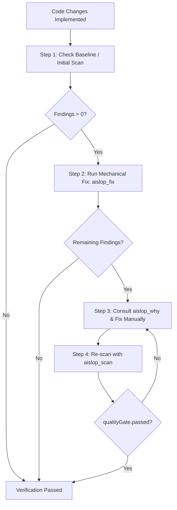

# aislop Code Quality & Anti-Slop Skill

This skill guides the agent in using **aislop** to inspect, fix, and maintain high code quality across multi-language projects (TypeScript, JavaScript, Python, Go, Rust, C#, C++, Ruby, PHP).

---

## When to Use This Skill

Activate this skill whenever:
- **Pre-Completion Quality Gate:** Verifying code changes before declaring work complete, committing, or opening a PR.
- **Automated Remediation:** Cleansing code from dead imports, narrative comments, duplicate imports, and formatting drift.
- **Quality Investigation:** Analyzing low quality scores, regressions against the project baseline, or explaining unfamiliar rules.
- **AI-Slop Cleanup:** Refactoring legacy or hastily-written AI code containing empty catch blocks, redundant try/catches, or unsafe type casts.

---

## Tool Capabilities & Interfaces

Prefer **MCP Tools** when available. If the MCP server is not mounted or offline, fallback to the equivalent **CLI commands**.

### 1. `aislop_scan` (CLI: `aislop scan [path]`)
- **Purpose:** Runs deterministic engines (`format`, `lint`, `code-quality`, `ai-slop`, `security`, `architecture`).
- **Inputs:** `path` (optional, defaults to project root).
- **Returns:**
  - `score` (0–100 integer score).
  - `qualityGate` (`passed: boolean`, `failBelow: number`, `errorCount: number`).
  - `counts` (summary of `error`, `warning`, `fixable`, `total`).
  - `findings` (top findings with file, line, rule, message, fixability, and assessment).
- **Rule of Thumb:** A run passes if `qualityGate.passed === true` and `counts.error === 0`.

### 2. `aislop_fix` (CLI: `aislop fix [--force]`)
- **Purpose:** Applies safe mechanical fixes automatically (formats code, removes unused/duplicate imports, strips narrative comments).
- **Inputs:**
  - `path` (optional).
  - `force` (optional boolean, runs aggressive fixes like package overrides or unused file removal).
- **Returns:**
  - `fixed` (number of resolved issues).
  - `scoreBefore` vs `scoreAfter` and `delta`.
  - `remaining` (count of issues needing manual developer attention).
- **Best Practice:** Run this FIRST before manual editing to save token budget on mechanical repairs.

### 3. `aislop_why` (CLI: `aislop rules [rule_id]`)
- **Purpose:** Explains a specific rule violation in depth.
- **Inputs:** `rule_id` (e.g. `ai-slop/narrative-comment`, `ai-slop/swallowed-exception`, `security/sql-injection`).
- **Returns:** Rule description, engine owner, pattern documentation URL, and recommended resolution pattern.

### 4. `aislop_baseline` (CLI: `aislop baseline` / `aislop hook baseline`)
- **Purpose:** Reads or inspects the captured quality baseline for the repository.
- **Returns:** Baseline score, last scan timestamp, and file count. Used to verify that new changes did not cause a quality regression.

---

## Step-by-Step Quality Workflow

Follow this 4-step sequence for any code modification task:

### Step 1: Pre-Scan
Execute `aislop_scan`:
- Note the score and count of `error` and `warning` diagnostics.
- Check if `qualityGate.passed` is true.

### Step 2: Mechanical Cleanup
Execute `aislop_fix`:
- Inspect the returned `delta` and `remaining` count.
- Review the diff to confirm mechanical changes are expected.

### Step 3: Manual Remediation
For any remaining unfixable findings:
- If unclear why a rule flagged your code, call `aislop_why(rule_id="...")`.
- Replace narrative comments with concise code or meaningful invariants.
- Replace swallowed catch blocks with explicit error logging or rethrow.
- Narrow loose types (`any`) to proper interface definitions.

### Step 4: Verification
Re-run `aislop_scan`:
- Ensure score meets or exceeds baseline (`aislop_baseline`).
- Ensure 0 errors remain before finishing the turn.
